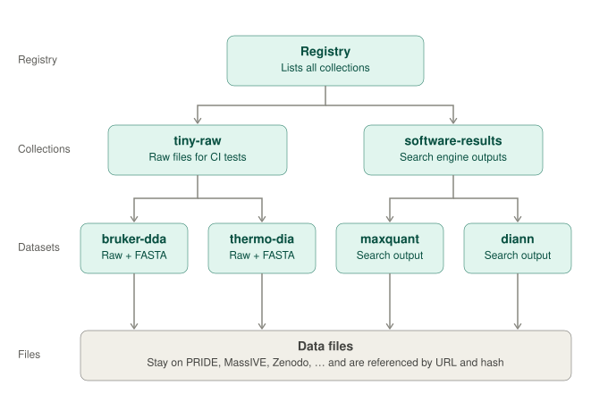
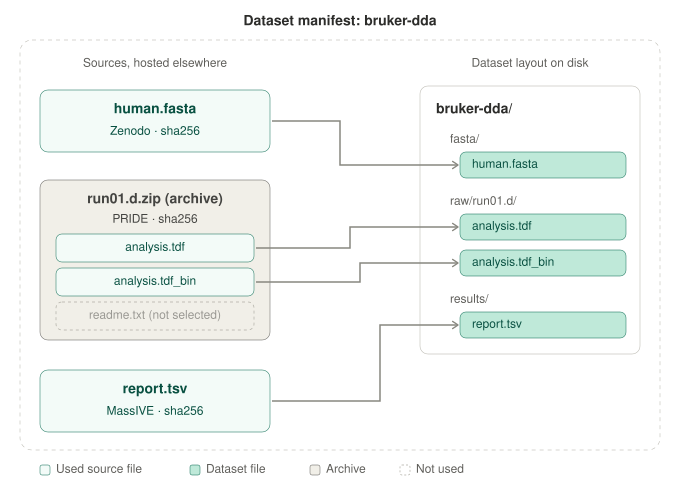
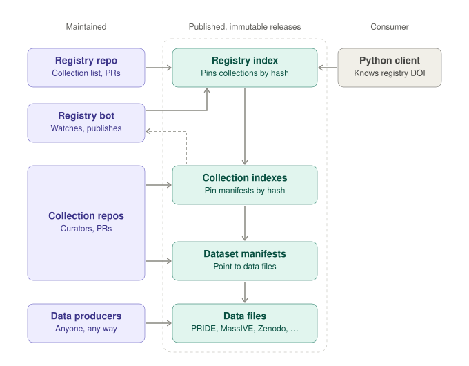
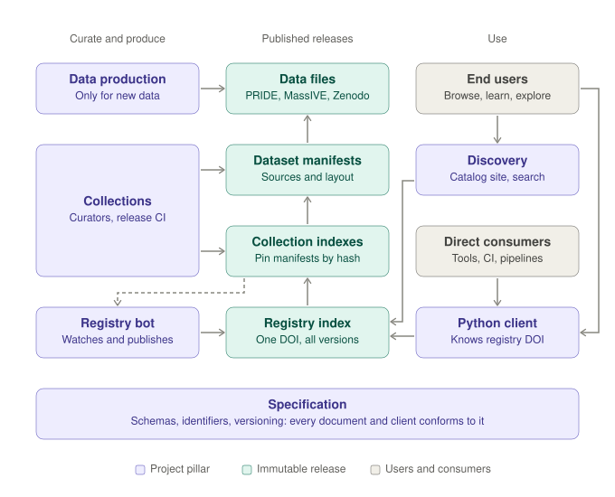

# Proteomics Dataset Collection: Project Overview

> **Status: draft design proposal, 2026-11-04.** This document introduces the current vision for the project. It is work in progress. Names, formats, hosts and workflows can still change based on feedback from collaborators.

## Introduction

The Proteomics Dataset Collection is a community collection of small, reusable proteomics datasets. The datasets support software development, automated testing (CI), examples and teaching.

Proteomics software needs small and reliable test data. Public datasets are often very large and difficult to find. Each project then collects its own test data, and other projects cannot use it.

This project solves that problem with three parts:

- A shared way to describe datasets: small metadata documents that tell software where to download each file and how to verify it.
- Curated collections of datasets, maintained by the community.
- A client that downloads a dataset with one command and puts it in a known location.

The project might also generate specific data collections itself, for example by acquiring raw files and running searches. The project does not run its own data storage. All files, including new data that the project produces, are on public repositories such as PRIDE, MassIVE and Zenodo. The project's main product is the metadata.

## How the data is organized

The data is organized in three levels. Each level is a small document that points to the level below it. The lowest level, the dataset manifest, points to the actual data files.



*Figure 1. Data model. The registry lists all collections. Each collection lists its datasets. Each dataset is described by a manifest that points to its data files. The data files stay on public repositories. The names are examples.*

- **Dataset.** A set of files that you use together, for example a few raw files and the FASTA file used to search them. A manifest describes each dataset.
- **Collection.** A group of datasets with a common purpose. For example, the collection tiny-raw contains very small raw files for CI tests. Each collection has its own curators.
- **Registry.** The official list of all collections in the project. Software always starts at the registry to find a dataset.

Each level has versions. A change makes a new version. A published version does not change.

## The dataset manifest

The manifest is the smallest unit of the project. It describes one dataset: which files to download, and where to put each file.



*Figure 2. Dataset manifest. The manifest lists the sources of a dataset, their hosts and their SHA-256 hashes. Each used file goes to a specified path in the dataset folder. From an archive, only the selected files are used.*

A manifest has these properties:

- **Sources from different hosts.** One dataset can combine files from Zenodo, PRIDE, MassIVE and other repositories.
- **Verified downloads.** Each source has a SHA-256 hash. The client compares the hash after each download.
- **Selected files from archives.** A source can be an archive, for example a zip file. The manifest lists only the files that the dataset needs, each with its own hash. The client ignores all other files in the archive.
- **A defined layout.** Each file goes to a specified path in the dataset folder. The result is a ready-to-use folder with the same structure on each computer.

This is a minimal prototype of a manifest. It is not a final schema. It deliberately has no descriptive metadata for now, for example instrument, license or citation.

```json
{
  "schema": "0.1",
  "id": "example-dataset",
  "version": "0.1.0",
  "sources": [
    {
      "url": "https://example.org/files/human.fasta",
      "sha256": "...",
      "size": 1234567,
      "path": "fasta/human.fasta"
    },
    {
      "url": "https://zenodo.org/records/.../files/run01.d.zip",
      "sha256": "...",
      "size": 41234567,
      "archive": "zip",
      "extract": [
        { "member": "run01.d/analysis.tdf", "path": "raw/run01.d/analysis.tdf",     "sha256": "...", "size": 123456 },
        { "member": "run01.d/analysis.tdf_bin", "path": "raw/run01.d/analysis.tdf_bin", "sha256": "...", "size": 40000000 }
      ]
    }
  ]
}
```

## Using a dataset

The commands below are a mockup. They show how working with the client could look, using a placeholder tool name, `pdc`. They are not a working or final interface.

```bash
# Fetch a whole dataset (pinned version); prints the dataset root path
pdc fetch dataset tiny-raw/bruker-timstof-ddapasef@1.2.0

# Fetch one dataset file; prints its path
pdc fetch file tiny-raw/bruker-timstof-ddapasef@1.2.0 fasta/human.fasta

# Fetch a dataset directory (e.g. one .d folder)
pdc fetch dir tiny-raw/bruker-timstof-ddapasef@1.2.0 raw/run01.d

# Export: same targets, plus a destination directory
pdc export dataset tiny-raw/bruker-timstof-ddapasef@1.2.0 --to ./tests/data
pdc export file    tiny-raw/bruker-timstof-ddapasef@1.2.0 fasta/human.fasta --to ./tests/data
```

## How the data is maintained and published

Curators maintain the collections. A bot keeps the registry up to date. Each published document is permanent and cannot change.



*Figure 3. Maintenance and release. Curators maintain collections in repositories and publish releases. The registry bot watches the collections and publishes a new registry version when a collection changes. The client knows only the location of the registry.*

1. **Curators maintain collections.** Each collection has a repository with its manifests and release tools. Anyone can suggest a change with an issue or a pull request. The curators review and accept changes. Data producers can create new data in any way. The registry has its own repository with the list of collections.
2. **Each release is permanent.** A collection release goes to Zenodo and gets a DOI. A published release does not change. A change makes a new release.
3. **A bot updates the registry.** The bot checks all collections on a schedule, for example each day. It also runs when a maintainer starts it. If a collection has changed, the bot validates it and publishes a new registry version. If nothing has changed, the bot does nothing.
4. **The registry is append-only.** A new registry version keeps all earlier entries and only adds new ones. An entry is small: it describes one collection release, for example with its URL and SHA-256 hash. The latest registry version therefore lists all releases of all collections.
5. **The client needs one address.** The registry has one Zenodo DOI. This DOI gives the latest version and all earlier versions of the registry.

Each link between documents contains a URL and a SHA-256 hash. The client can verify each document. From the registry, the client can reach each document and data file through these links. It needs no other lookup service.

Old versions are never deleted. If a version has an error, curators can withdraw it. The published version itself does not change, so the withdrawal is recorded in a later release, for example of the collection index or registry. The client then shows a warning.

## Project components and users

The project has six components. Three groups use them: curators, end users and direct consumers.



*Figure 4. Project overview. Curators produce data and release collections. The registry bot, which is part of the curation and release tools, updates the registry. End users find datasets in the catalog. End users and direct consumers get datasets through the client. The client always starts from the registry. The specification defines all documents.*

| Component | Purpose |
| --- | --- |
| Specification | Defines the format of all documents, the dataset identifiers and the version rules. All clients use it. |
| Client | Downloads, verifies and stores datasets. The first client is a Python library with a CLI. |
| Curation and release tools | Create, validate and release manifests and indexes. Include the registry bot. |
| Collections | Curated groups of datasets, each with its own curators. |
| Data production | Creates new data, for example very small raw files. Only some collections need it. |
| Discovery | Lets users search and browse datasets without downloads, for example on a catalog website. |

**End users** are people. They browse the catalog to find a dataset. Then they get it with the client, for example in a notebook or a tutorial.

**Direct consumers** are software tools and CI pipelines. They call the client directly. For CI, they should use a fixed version. This gives the same data in each run.

The specification does not depend on a programming language. Other clients, for example for R or Nextflow, can use the same registry.

## Open questions

This document gives an overview of the project vision. It is only a proposal, and everything in it can still change, not only the points below. These are some of the questions to answer together:

- **Hosting of releases.** This document uses Zenodo as the working assumption. Other hosts are possible. It is also open whether manifests are published one by one or inside the collection release.
- **Availability of sources.** What happens to a published dataset when a repository moves or removes a file?
- **Withdrawn versions.** Where is the withdrawn mark stored, because a published document cannot change? How does a client with a fixed version learn about it? Withdrawals could be recorded in the next release of the registry or collection index. Because the registry is append-only, a withdrawal recorded there would stay in all later registry versions.
- **Dataset versions.** What happens when we add another source to a dataset: does this change its version? Does the answer differ if the source adds new files or is only another location for an existing file?
- **Descriptive metadata.** Which metadata does a dataset need, for example instrument, license and citation, and where is it stored?
- **Governance.** Who accepts new collections, and what happens to a collection without active curators?

## Key terms

| Term | Meaning |
| --- | --- |
| Source | A file that the client downloads. It can be an archive. |
| Dataset | A set of files that you use together. |
| Manifest | The document that describes one dataset: its sources and its layout. |
| Collection | A group of datasets with a common purpose. |
| Collection index | The document that lists all datasets of a collection. |
| Registry | The official list of all collections. |
| Registry index | The append-only document that lists all releases of all collections. It is the start point for the client. |
| Curator | A person who maintains a collection or dataset. |
| Release | A published, permanent version of a document. |
